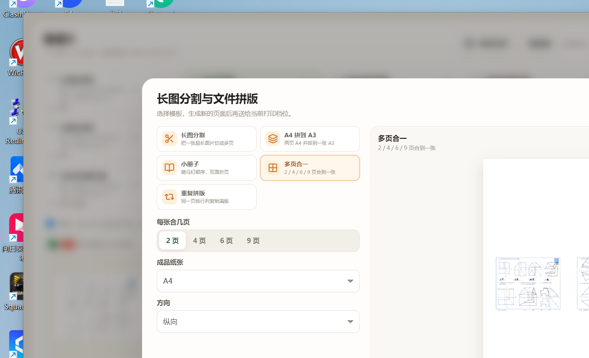

# 墨印 MoPrint

**免费、开源、本地优先的打印工作台。**  
墨印由 **allen-zhe** 维护，遵循 **AGPL-3.0-or-later**，面向打印店、自助打印和日常文件打印场景。



## 功能

- **文件堆叠**：手动新建、拖拽导入、目录监听、按时间窗口自动归堆。
- **12 个快捷档位**：A4/A3、黑白/彩色、单面/双面短翻/长翻，拖入文件即可打印。
- **PDF / 图片 / 文本**：PDF 页数、缩略图、页码范围、跳过空白页；JPG/PNG/WEBP/BMP/GIF/TIFF；TXT 自动分页。
- **长图分割**：把一张超长图片按 A4/A3 切成多页，可设置页间重叠。
- **文件拼版**：A4 拼到 A3（自动识别横竖）、小册子、多页合一（2/4/6/9 页，方向随成品纸张）、重复拼版。
- **打印设置**：价格方案、单价、颜色、纸张、单双面、方向、打印机分配、导入/导出、批量编辑、Excel 式列宽调节。
- **打印机能力与自动分配**：首次启动读取每台打印机的彩色/黑白、双面、最大纸张和可用纸张，自动把打印项目分配给匹配的打印机；黑白优先黑白机，无黑白机回退彩色机，A3 优先 A3 机器。打印前校验不支持的颜色/纸张/双面。
- **纸张真实生效**：文档打印由 C# `PrintJob.exe` 设置驱动级纸张/颜色/双面，A3 档位不会再被驱动默认的 A4 覆盖或切分。
- **混合横竖版**：同一堆叠中竖版照片和横版 PDF 混合时，逐页判断方向并逐页切换 A4 横向/纵向，横版 PDF 保持横向，不再被压到竖版。
- **照片纸**：支持 5寸/6寸/7寸/8寸（以及 A4/A3/A5/Letter），照片按 300/600 DPI 渲染，可配合「铺满纸张」做无边距照片。
- **PDF 检查机**：新增应用内虚拟打印机「墨印 PDF 检查机」，支持 A3/A4、黑白/彩色；选中后输出 PDF 到任意位置，先检查排版再出纸。
- **高清 PDF**：PDF 以 300 DPI（可选 150/600）渲染为无损 PNG 页面，避免旧版 JPEG 二次压缩；实际矢量透传能力取决于打印机驱动。
- **打印机首选项**：C# `PrintPrefs.exe` 通过 `DocumentProperties`/DEVMODE 打开驱动设置界面，设置驱动级纸张、颜色、双面等参数。
- **取件标签**：二维码、订单号、客户、页数、金额、收款状态、打印机序号、纸张/九宫格位置/缩放。
- **覆盖率估算**：按页面非白像素比例估算墨粉/墨水覆盖率，显示在打印任务与堆叠详情中。
- **收款统计**：今天/昨天/近 7 天/本月/自定义日期，收款、补收、退款流水。
- **手机传输**：电脑开启局域网服务，手机扫码上传；文件不经过互联网。
- **ERP 预留接口**：标准订单/流水/客户适配器，配置后可推送，不启用时完全不联网。
- **桌面体验**：无边框窗口、托盘、窗口置顶、独立快捷打印窗口、撤销/重做、自动保存。

## 技术栈

| 层 | 技术 |
| --- | --- |
| 桌面容器 | Electron 33（Chromium + Node.js） |
| 前端 | React 18 + Vite 5，原生 CSS |
| PDF | PDF.js，页面位图化后排版打印 |
| 打印 | Electron `webContents.print` + Windows 打印驱动；驱动首选项由 C# `PrintPrefs.exe` 打开 |
| 文件监听 | chokidar |
| 手机传输 | Node HTTP + busboy，手机端为内联响应式页面 |
| 二维码 | qrcode |
| 数据 | 本机 JSON，原子写入 `%APPDATA%\moprint\state.json` |

## 开发

要求：Windows 10/11，Node.js 20 或 22。

```powershell
npm install
npm run start        # 构建前端并启动 Electron
npm run build        # 只构建前端
npm run dist:dir     # 生成 release/win-unpacked
npm run dist         # 生成安装版 + 便携版
```

`npm run dist` 的流程：

1. 构建前端；
2. 打包 `release/win-unpacked`；
3. `tools/stamp.js` 写入版本信息和图标；
4. 用已打包目录生成 NSIS 安装版与便携版。

## 检查打印（PDF 检查机）

在打印设置、堆叠详情或快捷档位里把打印机选为 **「墨印 PDF 检查机」**，点击打印后会弹出保存对话框，可保存到任意目录。它支持 A3/A4、黑白/彩色配置，并按每一页的实际方向生成 PDF，适合在不耗纸的情况下检查横竖版混排、拼版和边距。

## 安装版

安装包位于 `release/墨印-1.0.0-安装版.exe`：

- 显示 AGPLv3 许可页，必须同意后才能继续；
- 可自由选择安装目录；
- 创建桌面与开始菜单快捷方式；
- 安装时静默尝试启动 Windows 打印后台服务并创建 `%APPDATA%\moprint` 数据目录；
- Electron 自带 Chromium/Node 运行时，无需额外安装 WebView2 或 .NET。

便携版：`release/墨印-1.0.0-便携版.exe`，双击运行。

## 手机传输

1. 点击顶部「手机传输」；
2. 手机连接同一 Wi-Fi，扫描二维码；
3. 选择 PDF/图片，文件自动进入电脑堆叠。

端口默认 18666，被占用时自动顺延。接收服务只在局域网监听，文件不会上传互联网。

## 快捷键

| 快捷键 | 功能 |
| --- | --- |
| `Ctrl + Q` | 显示主窗口 |
| `P` | 打印当前堆叠 |
| `Ctrl + W` | 关闭当前堆叠并打印标签 |
| `Ctrl + E` | 关闭当前堆叠且不打标签 |
| `Ctrl + Z` | 撤销 |
| `Ctrl + Alt + Z` | 重做 |
| `Esc` | 关闭弹窗 / 打印队列 |

## 项目结构

```text
electron/
  main.js       窗口、托盘、IPC、打印、打印机首选项、ERP 桥
  preload.js    安全 API
  printer.js    打印机枚举、C# 首选项/打印桥、隐藏窗口回退
  receiver.js   局域网接收与手机页面
  store.js      JSON 原子持久化
  defaults.js   默认价格方案和设置
src/
  MainApp.jsx   主工作台状态与打印流程
  QuickApp.jsx  独立快捷打印窗口
  components/   堆叠、详情、打印设置、标签、统计、拼版等
  lib/          PDF、打印 HTML、拼版、标签、ERP、覆盖率
build/
  PrintPrefs.cs C# 打印机驱动首选项（DocumentProperties/DEVMODE）
  PrintCaps.cs  C# 打印机能力（DeviceCapabilities/PrinterSettings）
  PrintJob.cs   C# 文档打印（PaperSize/Color/Duplex）
build/
  icon.svg      橙色品牌图标
  license.txt   AGPLv3（安装许可页）
  installer.nsh 安装环境检查
docs/
  technical-notes.md
```

## 开源协议

本项目采用 **GNU General Public License v3.0 or later**。你可以自由使用、修改、分发；分发修改版时需保留同样的自由，并提供对应源码。

完整协议见 [LICENSE](LICENSE)。安装包会在安装向导中展示同一份协议并要求同意。

## 反馈与后续

- 项目主页：`https://github.com/allen-zhe/MoYin`
- 问题反馈：`https://github.com/allen-zhe/MoYin/issues/new/choose`

仓库地址目前是预留的正式地址；如果之后更换组织或仓库名，只需修改 `src/lib/constants.js` 中的 `GITHUB_URL` / `GITHUB_ISSUES_URL`。

## 已知边界

- 暂不原生支持 Word/Excel/PPT，需先转 PDF。
- 实际打印质量、双面翻转、纸张来源由 Windows 打印机驱动决定，不同驱动支持度不同。
- 手机传输使用随机连接码，不做账号鉴权，请只在可信 Wi-Fi 使用。
- ERP 接口默认关闭；未配置时不会发起网络请求。
- 便携版未做代码签名，Windows 首次运行可能出现 SmartScreen 提示。


